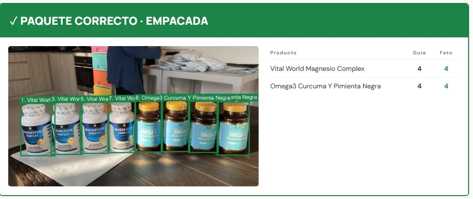
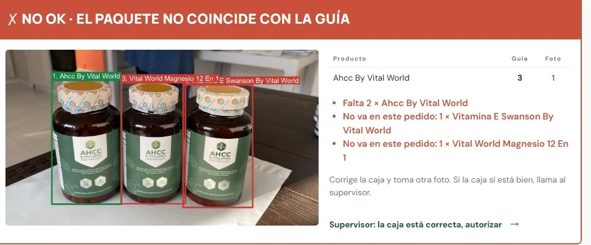
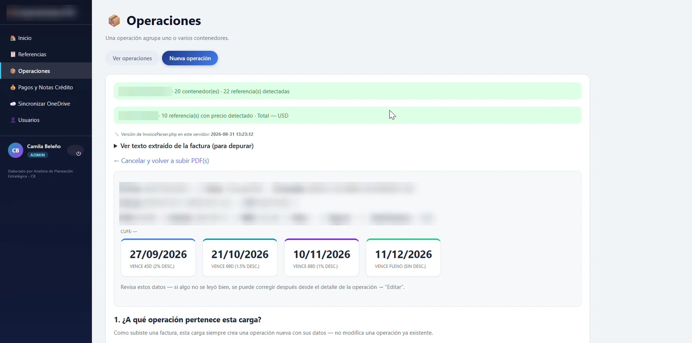

  <picture>
    <source media="(prefers-color-scheme: dark)" srcset="public/brand/cb-logo-horizontal-blanco.svg">
    
  </picture>

  <b>Software a la medida para la operación:</b> visión artificial, sistemas web, datos y automatización. 
  Ing. Camila Andrea Beleño Cabrales · Colombia

  <a href="https://camila-b14.github.io/Portafolio_CamilaB/"><b>Ver el portafolio web →</b></a>

---

## Proyectos

### 01 · PackCheck — despacho verificado con visión artificial
`En piloto en producción` · React · FastAPI · PostgreSQL · PyTorch · YOLO-World · DINOv2 · OCR · Azure

Sistema a la medida para el área de despacho de una empresa colombiana de e-commerce. Carga en bloque los documentos de pedidos del día que exportan las plataformas de venta, entiende qué lleva cada pedido, lo pasa a la mesa de empaque y allí verifica cada caja con visión artificial antes de cerrarla. Tiene roles, autorizaciones del supervisor con evidencia fotográfica y métricas diarias.

**Carga masiva → lectura de pedidos → mesa de empaque → visión artificial → métricas**

| Caja correcta | Faltan productos |
|---|---|
|  |  |

- 77 de 77 guías leídas y cuadradas en cortes reales.
- 0 de 45 cajas incorrectas aprobadas en la prueba de visión; 14 de 15 cajas correctas aprobadas.
- 45 pruebas automáticas con documentos reales.

> Código privado del cliente; aquí se presenta el caso.

### 02 · Sistema de importaciones — de PDF a operación
`En uso` · PHP · Python · Streamlit · pandas · Plotly · Microsoft Graph

Lee la orden de compra y la factura del proveedor en PDF, detecta contenedores, referencias y costos, los cruza con el catálogo y calcula los vencimientos de pago con sus descuentos por pronto pago. Incluye pagos y notas crédito, sincronización con OneDrive, usuarios por rol y un tablero de control.

> Datos del proveedor, códigos y costos difuminados por confidencialidad. · [Código del tablero](https://github.com/Camila-B14/Dashboard_logistica_distribucion_PYS)

### 03 · Sistema para fábrica de ductos
`Sistema a la medida` · Caso en preparación.

### 04 · MVP para finanzas
`En desarrollo` · Producto propio para el público de finanzas.

### 05 · Automatizaciones con n8n
`Documentando` · Flujos que conectan herramientas y eliminan tareas repetitivas.

---

## Herramientas

**Desarrollo web:** React, Vite, FastAPI, PHP, SQLAlchemy, PostgreSQL
**Visión artificial:** PyTorch, YOLO-World, DINOv2, RapidOCR
**Datos:** Python, pandas, Plotly, Streamlit, Excel
**Nube y automatización:** Azure, Microsoft Graph, OneDrive, n8n

## Contacto

cabcabrales1403@gmail.com

---

<b>Sobre este repositorio (el sitio web)</b>

El portafolio es una página en **React + Vite**, animada con **Framer Motion** y con una escena 3D en **Three.js / React Three Fiber**. Se publica sola en GitHub Pages con cada cambio en `main` (`.github/workflows/deploy.yml`).

- Todo el contenido (proyectos, textos, métricas, imágenes y videos) está en `src/data.js`.
- Las imágenes van en `public/media/<proyecto>/` (ver `public/media/LEEME.md`).
- Para verlo en tu computador: `npm install` y luego `npm run dev`.

